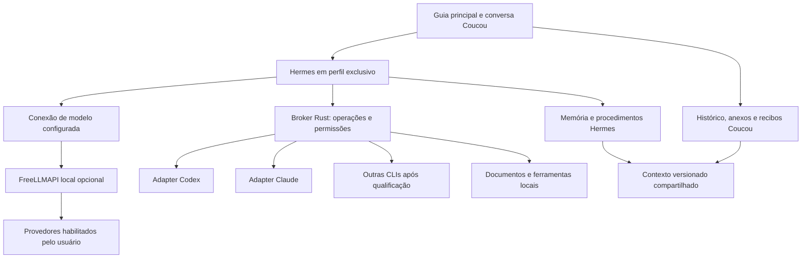

# Plano: Hermes como supervisor do Coucou e APIs gratuitas opcionais

**Data:** 06/10/2026

**Status:** autorizado pelo usuário; implementação Windows 0.1.4 em qualificação. O plano não concede acesso permanente a ferramentas ou provedores.

**Base:** Coucou Windows 0.1.3, commit `682af47`, branch `codex/multiagent-windows`.

**Decisão:** [ADR-001 — Hermes como supervisor](ADR-001-HERMES-COMO-SUPERVISOR.md).

**Escopo da primeira entrega:** o personagem Hermes usa o runtime ACP real e solicita operações pela ponte Coucou. Codex/Claude ainda abrem seus canais diretos, compartilhando contexto. A seleção fica só na guia principal; não foi implementada a conversão de todo personagem especialista em preferência do supervisor. O agente pessoal pode ser renomeado; personalização arbitrária de avatar permanece posterior. FreeLLMAPI aceita Groq/Cerebras com modelo exato e sem fallback. Os auxiliares são somente leitura, até dois por turno, executados sequencialmente. O escritor persistente da memória continua sendo o Rust/SQLite; Hermes fornece propostas tipadas e recebe snapshots. O mecanismo nativo completo de memory/skills do Hermes fica bloqueado. Consulte a [validação](VALIDACAO-HERMES-FREELLMAPI-WINDOWS-2026-10-06.md) antes de tratar uma fase como homologada.

## 1. Objetivo e experiência final

Preservar a ilha, os personagens e o visual atual. Integrar o runtime real do Hermes para compreender pedidos, recuperar contexto, aprender preferências e procedimentos e delegar trabalho às CLIs gerenciadas pelo Coucou. Acrescentar um agente pessoal com nome e aparência escolhidos pelo usuário, que pode usar modelos com cotas gratuitas através de um FreeLLMAPI local.

- O usuário escolhe o agente clicando em seu personagem na guia principal. O chat mostra o personagem ativo, sem outra seleção de CLI ou de fornecedor.
- O personagem pessoal, inicialmente chamado Hermes, responde e coordena especialistas. Clicar em Codex ou Claude indica o especialista preferido para o próximo pedido; a orientação só é enviada depois de uma ação de envio do usuário.
- Os resultados e o contexto aparecem em uma conversa contínua. As sessões internas de Hermes e das CLIs continuam separadas.
- Resend, n8n, Vercel e GitHub continuam sendo conexões/ferramentas. Não serão apresentados como modelos de linguagem nem ganharão um chat fictício.
- Arrastar um arquivo o anexa localmente. A interface oferece **Ler e resumir** e **Fazer uma pergunta**, deixando claro quando o conteúdo será compartilhado com um modelo remoto.
- O modo gratuito é opcional. Ao ativá-lo, o usuário configura os provedores disponíveis, nomeia seu agente e escolhe iniciar o serviço automaticamente ao entrar no Windows.

Hermes é o runtime do agente; FreeLLMAPI fornece uma conexão com modelos; Codex, Claude e as demais CLIs são executores. São responsabilidades diferentes.

## 2. Evidências e limites atuais

Auditoria somente leitura do código em 06/10/2026:

| Área | Evidência atual | Consequência para o plano |
| --- | --- | --- |
| Guia principal | `windows/src/views/views.ts:257` e `:295` já selecionam o agente e abrem o chat | Reaproveitar esse fluxo como escolha única |
| Escolha duplicada | `windows/src/views/chat.ts:26` desenha quatro personagens novamente; `:49` contém seleção avançada de conversa | Remover a duplicação do chat; manter inspeção de sessões sem obrigar escolher uma CLI |
| Hermes | `windows/src-tauri/src/memory/mod.rs` registra uma implementação própria, inspirada no Hermes | Ainda é necessário integrar e qualificar o runtime real |
| Provedores | `agent_chat/mod.rs:69` bloqueia Gemini/Copilot antes da execução | O supervisor não pode contornar essa restrição |
| Anexos | `island.ts:518` conclui progresso por tempo; `:500` fecha a apresentação do erro após 2,4 segundos | Progresso e erro precisam refletir a operação real |
| Envio sem pergunta | `chat.ts:123` retorna sem feedback quando o texto está vazio | Anexo sem texto precisa de uma ação concreta, como Ler e resumir |
| Importação e leitura | `personal_runtime.rs:129` prepara conteúdo no início do turno | Importado, lido e enviado são etapas distintas |
| Imagens | `documents/storage.rs:323` marca imagens como não suportadas para leitura | Implementar visão/OCR separadamente; não anunciar leitura disponível antes disso |
| Limites | `documents/storage.rs:235`: até 10 anexos, 20 MiB por arquivo e 50 MiB por lote | Exibir limite acumulado do contexto e permitir administrar anexos |

Esses achados explicam possíveis falhas de experiência; não comprovam uma única causa do bloqueio relatado. A reprodução nativa de drag/drop OLE, com o arquivo e caminho reais, é um gate da primeira fase. Testes do parser não comprovam entrega de um arquivo pela interface nativa.

## 3. O que significa a oferta gratuita

O FreeLLMAPI anuncia uma soma de 7,4 bilhões de tokens mensais entre cotas de provedores. O acesso depende das contas/chaves configuradas e de seus limites; isso não representa um saldo garantido por usuário. Seu roteador é local, mas a inferência dos provedores remotos acontece fora da máquina. O plano não promete disponibilidade ou acesso ilimitado. [Projeto oficial](https://github.com/tashfeenahmed/freellmapi).

Na interface, usar **Modelos com cotas gratuitas**, mostrando apenas fontes habilitadas, limites conhecidos e horário da consulta. Não exibir um contador pessoal de 7 bilhões. Provedores pagos, créditos promocionais que possam gerar cobrança e troca automática para APIs pagas ficam fora da política gratuita.

O supervisor pode usar cotas gratuitas e ainda delegar a uma CLI com plano próprio: Codex/Claude autenticados continuam consumindo seus respectivos planos. Redirecionar também essas CLIs ao roteador é uma evolução separada, com teste de protocolo e configuração por processo; não acontece silenciosamente nesta primeira integração.

O roteador será opcional, isolado do chat CLI existente e versionado. A versão pesquisada é `a6b2158c7c36ce19f888d0411846a1a0f2aa3f06`; revisar licença MIT, dependências, integridade e atualizações antes de distribuir. O código de servidor usa Node com dependência SQLite nativa. Recomenda-se runtime próprio Node 22 compatível com a versão escolhida, sem depender de instalação global do usuário. [Pacote](https://github.com/tashfeenahmed/freellmapi/blob/a6b2158c7c36ce19f888d0411846a1a0f2aa3f06/package.json).

## 4. Arquitetura proposta



### 4.1 Runtime Hermes

Integrar por ACP/stdio, com profile/home exclusivo do Coucou, sem reaproveitar automaticamente `~/.hermes`, plugins, ferramentas, MCP ou credenciais globais. ACP mantém o Coucou como interface e permite receber resposta, atividade e solicitações de permissão. Seu conjunto padrão de ferramentas é amplo: o perfil gerenciado deve permitir apenas ferramentas aprovadas da ponte Coucou, além dos recursos de memória/skills qualificados. [ACP oficial](https://hermes-agent.nousresearch.com/docs/user-guide/features/acp/).

A documentação atual oferece instalação Windows nativa. O spike deve verificar descoberta do launcher, ACP, cancelamento e distribuição nessa plataforma. Não exigir WSL ou Docker como dependência inicial. Usar runtime gerenciado separado do Node do FreeLLMAPI; fixar origem, dependências e hash dos pacotes. Referência Hermes pesquisada: `781334eea4b9225a3e194faf0c241d9afe218634`. [Instalação](https://hermes-agent.nousresearch.com/docs/getting-started/installation/).

Não instalar o aplicativo desktop completo do Hermes nem o do FreeLLMAPI para renderizar suas interfaces dentro da ilha. Qualificar seus componentes de runtime e servidor para evitar duas novas interfaces e dois mecanismos de autostart competindo com o Coucou.

### 4.2 Delegação às CLIs

Criar uma ponte de ferramentas tipadas entre Hermes e o broker Rust, preferencialmente MCP/stdio após spike. Os nomes abaixo são contratos propostos, não endpoints existentes:

| Operação proposta | Dados mínimos | Garantia |
| --- | --- | --- |
| Consultar agentes | Perfil, capacidades e estado | Não inicia modelo nem sessão |
| Delegar tarefa | Agente executor, objetivo, contexto selecionado e anexos | O Rust decide binário/argumentos; o modelo não fornece shell arbitrário |
| Consultar execução | IDs de tarefa/turno | Estado observado, sem repetir a tarefa |
| Cancelar execução | IDs e vínculo de propriedade | Cancela só o processo gerenciado correspondente |
| Operar arquivos | Operação tipada e alvo canônico | Reutiliza concessões restritas atuais |

Reaproveitar `AgentChatManager`, transportes, controle de processos/Jobs e recibos de envio. Separar chamadas de modelo, delegações e execução de ferramentas. Não usar automação de interface para digitar instruções em terminais ou outros aplicativos.

A delegação nativa do Hermes não é automaticamente um adapter das quatro CLIs. A ligação com executores externos é trabalho desta integração. Começar com Codex, depois Claude; Gemini/Copilot entram somente após validação independente. Limite proposto inicial: um supervisor, dois executores concorrentes e uma camada de delegação, com orçamento por tarefa. [Delegação oficial](https://hermes-agent.nousresearch.com/docs/user-guide/features/delegation/).

### 4.3 Identidade e eventos

Introduzir `AgentProfileId` separado de `provider` e de `executor`. O perfil contém nome, avatar, papel, conexão de modelo e capacidades. Tarefas recebem `taskId`, `runId`, `parentRunId`, perfil, contexto, executor e recibos de ferramenta.

Estados propostos: aguardando, preparando, executando, aguardando permissão, cancelando, concluído, falhou e resultado incerto. Eventos têm identificação e sequência para deduplicação. Trocar de personagem altera a escolha futura, sem redirecionar uma execução em andamento, cancelar outro agente ou autorizar retomada externa.

## 5. Navegação e personagens

1. A guia principal concentra os personagens conversacionais. O personagem pessoal nomeável aparece ao lado dos executores disponíveis, mantendo o desenho do print.
2. Um clique seleciona o perfil e abre sua conversa/contexto comum. Não dispara tarefa automaticamente.
3. Remover a barra duplicada de personagens do chat e qualquer seleção de executor ali. Mostrar somente nome/avatar ativo, atividade, anexos, entrada e contexto.
4. Configuração de modelos, contas, rotas e sessões fica em Configurações. O usuário cotidiano não precisa entender CLI, ACP, porta ou base URL.
5. A escolha de um especialista é uma preferência explícita para o pedido; o supervisor não a troca silenciosamente. Quando não houver especialista escolhido, Hermes pode responder diretamente ou delegar conforme a tarefa e a política.
6. Item indisponível informa o motivo e permite monitoramento. Disponibilidade de uma API Gemini não habilita a CLI Gemini bloqueada.
7. Exibir quem respondeu, quem executou a tarefa e quais modelos participaram. Renomear o agente não oculta a origem do processamento.

## 6. Corrigir e unificar anexos primeiro

Reutilizar o serviço de documentos e sua cópia protegida. O mesmo fluxo atende drop e seletor; captura contexto e agente no começo da operação. O original permanece intacto.

```text
Escolhido → Importando → Anexado localmente → Preparando leitura
         → Pronto / Leitura parcial / Não suportado / Falha
         → Compartilhando com o modelo → Resposta recebida
```

- Progresso vem da operação real; enquanto não houver medida, mostrar atividade indeterminada. Animação não confirma sucesso.
- Exibir situação por arquivo, cobertura, limites e erros persistentes. Explicar bloqueios por turno ativo, importação, pausa ou fornecedor indisponível.
- Expor cancelamento e deadline de importação; toda conclusão ou falha libera o estado ocupado. Resultado tardio não altera outro contexto.
- Anexo sem texto oferece Ler e resumir ou Fazer uma pergunta. Soltar arquivo não inicia chamada remota silenciosamente.
- TXT/MD/código, PDF textual e DOCX são a primeira entrega. Visão/OCR entra depois com modelo e fluxo comprovados; PDF escaneado e imagem sem capacidade recebem mensagem específica.
- Arquivos OneDrive, atalhos, reparse e caminhos de rede precisam de diagnóstico próprio. Não remover recusas de segurança para mascarar um erro de envio.
- A extração e os trechos selecionados são reutilizados para Hermes e delegação, respeitando referências e orçamento. Delegar não precisa reenviar o documento inteiro para todos os agentes.
- Permitir remover anexos e explicar o limite acumulado da conversa contínua. Nenhuma falha apaga anexos anteriores.
- Documento é conteúdo externo; suas instruções não concedem ferramentas, permissões, mensagens ou autostart.

## 7. Ativação do modo gratuito e serviço local

### Primeiro uso

Pergunta proposta: **“Deseja usar modelos com cotas gratuitas? Você precisará configurar os provedores disponíveis. As mensagens e os documentos selecionados serão enviados aos provedores habilitados.”** Opções: Configurar agora e Continuar sem ativar. A resposta é persistida; não repetir a pergunta a cada inicialização.

Ao configurar:

1. Escolher nome/avatar do agente pessoal.
2. Mostrar provedores e capacidades disponíveis; o usuário autoriza quais podem receber seus dados.
3. Inserir chaves em campos protegidos ou conectar contas pelos fluxos oficiais. Não importar logins globais silenciosamente.
4. Conferir conectividade/autenticação sem enviar histórico ou documentos. Um teste de inferência é separado, explícito e mínimo.
5. Qualificar um modelo para o supervisor e, se desejado, uma cadeia gratuita de fallback. Não usar `auto` irrestrito antes da qualificação de ferramentas e contexto.
6. Mostrar a opção **Iniciar o serviço ao entrar no Windows**, com seu estado explícito. Confirmar a ativação na interface após persistência e verificação.

Existe uma receita oficial `setup-hermes` usando endpoint customizado, chat completions e o `HERMES_HOME` selecionado. Usá-la como referência de configuração, sem executar geradores que alterem o perfil global. Esse apoio não substitui o turno real de qualificação do nosso perfil. [Receita Hermes do FreeLLMAPI](https://github.com/tashfeenahmed/freellmapi/blob/a6b2158c7c36ce19f888d0411846a1a0f2aa3f06/docs/en/clients/01-agent-clients.md#hermes-agent-hermes).

Hermes também pode usar um provedor configurado separadamente quando o modo gratuito não estiver habilitado; login de uma CLI não garante conexão automática com o supervisor. A documentação lista conexões de assinatura/OAuth e endpoints customizados, a qualificar no perfil Coucou. Sem modelo conectado, conservar o chat CLI existente e informar a indisponibilidade do supervisor. [Provedores Hermes](https://hermes-agent.nousresearch.com/docs/integrations/providers).

### Ciclo do serviço

- Supervisor de processo pertencente ao usuário, sem administrador e sem Windows Service de sistema. Iniciar após login, pois contas e chaves pertencem ao perfil; não antes do login.
- Manter preferências independentes para iniciar o aplicativo e iniciar o roteador gratuito. Usar uma instância única de supervisão e registrar a propriedade/origem do autostart, evitando entradas concorrentes e outro Electron residente. Se apenas o serviço foi habilitado para iniciar, a inicialização deve ser discreta, sem exigir abrir o chat.
- Escutar apenas em `127.0.0.1`, com autenticação, porta registrada e validação de identidade do processo. Não confiar em qualquer serviço que já ocupe a porta. Não abrir firewall, LAN ou túnel.
- O servidor genérico pesquisado aceita bind amplo por padrão; forçar loopback na configuração gerenciada. Proteger chaves de provedor no armazenamento criptografado do FreeLLMAPI e o segredo local no mecanismo protegido do Windows, sem duplicar chaves em logs/banco pessoal.
- Inicializar o servidor habilitado; iniciar Hermes sob demanda. Nenhum prompt, aprendizado com modelo, retomada de chat ou tarefa nasce só porque a máquina ligou.
- Crash pode reiniciar infraestrutura com backoff limitado. Nunca retomar automaticamente tarefas nem reenviar mensagens de resultado incerto. Fechar/parar explicitamente respeita a intenção de parada.
- Desativar para apenas o roteador próprio e remove somente um registro criado exclusivamente para esse serviço. Preservar a preferência e a entrada preexistentes de inicialização do Coucou para os canais CLI. Histórico e dados permanecem; parada manual, diagnóstico e desinstalação são ações separadas.
- Distribuir releases fixadas com integridade e licenças; atualização de runtime é explícita. Atualização de catálogo nunca amplia a lista de destinos autorizados.

Persistir e proteger a chave mestra do banco do roteador; não regenerá-la no boot. Chave unificada é entregue ao Hermes por ambiente restrito, sem argumento de processo nem script com segredo. Cache persistente de respostas e fluxos extras de compressão/handoff ficam desligados na primeira entrega. A criptografia das chaves não comprova criptografia de prompts/respostas; revisar também a retenção dos recibos de idempotência do roteador. [Criptografia](https://github.com/tashfeenahmed/freellmapi/blob/a6b2158c7c36ce19f888d0411846a1a0f2aa3f06/server/src/lib/crypto.ts), [configurações](https://github.com/tashfeenahmed/freellmapi/blob/a6b2158c7c36ce19f888d0411846a1a0f2aa3f06/.env.example).

## 8. Contexto e aprendizado reais do Hermes

Na primeira integração, o Hermes produz propostas semânticas de memória e procedimentos através de `memory_propose` e `skill_propose`. O Rust/SQLite do Coucou permanece o único escritor persistente, aplica a política de origem/curadoria e conserva o registro da conversa, anexos, tarefas, permissões e recibos. O contexto aprovado é espelhado no perfil privado Hermes; suas ferramentas nativas de memória/skills ficam desativadas. Isso preserva a revisão em Contexto sem dois mecanismos concorrentes escrevendo o mesmo conhecimento. É uma adaptação do aprendizado, não a habilitação do mecanismo nativo completo do Hermes. [Memória oficial](https://hermes-agent.nousresearch.com/docs/user-guide/features/memory).

A fase de memória deve:

1. Inventariar e fazer backup de dados atuais; importar preferências/procedimentos confirmados com origem, sem importar permissões como hábitos executáveis.
2. Mapear mudanças Hermes para a tela Contexto, com conteúdo, evidência, revisão/hash e origem. Definir um escritor por domínio; desativar a curadoria duplicada do Coucou apenas no perfil migrado.
3. Propagar um snapshot aprovado aos executores no início de cada tarefa. Eles retornam evidências e não gravam concorrencialmente a memória do supervisor.
4. Manter o aprendizado natural durante os pedidos, sem botão Aprendizado. Correções explícitas de baixo risco podem ser consolidadas; procedimento com efeitos externos permanece sujeito às permissões próprias.
5. Exigir persistência confirmada antes de anunciar “lembrei”. Correção e esquecimento refletem-se em Contexto e em novos snapshots.
6. Preservar uma timeline única, mas criar limites internos de sessão entre tarefas concluídas, quando necessário. Orçamentos e recuperação evitam uma sessão infinita que reenvia todo o histórico.
7. Não iniciar revisão periódica, cron ou heartbeat por padrão. Curadoria adicional com modelo tem orçamento e política explícitos e nunca orienta chats externos.

O snapshot aprovado é formado por registros promovidos pela política de origem, não por uma confirmação humana a cada turno. Preferências declaradas diretamente pelo usuário e correções explícitas de baixo risco podem ser promovidas automaticamente, com evidência e possibilidade de desfazer. Afirmações extraídas de documentos, ferramentas e executores ficam como candidatos ou fatos com sua origem indicada; não se tornam preferências/instruções autoritativas por conta própria. Uma autorização explícita do usuário para adotar um procedimento é registrada separadamente, sem converter esse procedimento em concessão para executar seus efeitos.

O spike deve confirmar os callbacks e a sincronização da memória nativa com a UI. Se a revisão exigida não puder ser aplicada com extensões suportadas, registrar a limitação e implementar um adapter estreito; não fazer uma sincronização bidirecional opaca nem editar arquivos de usuário em paralelo.

## 9. Permissões, deduplicação e dados

A decisão final de ferramentas permanece no Rust. Ferramentas arbitrárias de terminal, execução de código, plugins, MCP herdados, mensagens e agendamento ficam indisponíveis no perfil gerenciado até qualificação própria. Verificar o conjunto efetivo de ferramentas; lista vazia em uma configuração não é prova de isolamento.

Para chats que esta tarefa não criou: mostrar título/ID e mensagem completa, exigir confirmação para uma única tentativa, consumir a autorização uma vez e impedir duplicatas. Aprendizado, delegação, renomeação de agente e ativação da API gratuita não concedem essa permissão. [Política existente](CONTROLE-DE-MENSAGENS-ENTRE-CHATS.md).

Manter ledger e lock no Coucou por turno, destino e execução de ferramenta. O FreeLLMAPI não deduplica inferências concorrentes, e seu suporte a `Idempotency-Key` não substitui esse controle em streaming. Após timeout/resultado incerto, não reenviar tarefas às CLIs automaticamente. Chamada de modelo repetida não pode repetir uma ferramenta já executada. [Implementação pesquisada](https://github.com/tashfeenahmed/freellmapi/blob/a6b2158c7c36ce19f888d0411846a1a0f2aa3f06/server/src/services/idempotency.ts).

A lista de destinos remotos é autorizada no setup. Fallback só ocorre entre destinos aprovados e compatíveis. Mudança para destino novo ou envio a uma CLI fora do escopo requer nova decisão. Cancelamento interrompe o trabalho local e sinaliza aborto da requisição, sem prometer apagar dados já recebidos por um provedor.

Validar schema e permissões de toda ferramenta no broker, mesmo quando o gateway aceita ou reconstrói um tool call. Qualificar orçamento por requisição, limite de falhas e a validação de argumentos do gateway, sem tratá-los como substitutos da validação Rust. Um modelo que não obedece ao contrato pode atender conversa simples, mas não recebe delegação operacional.

## 10. Uso e observabilidade

- Separar tokens do supervisor, curadoria, executores e tentativas do roteador, evitando soma duplicada do mesmo evento.
- Registrar modelo/provedor efetivo, fonte, versão, horário e qualidade de cada dado: observado, estimado, parcial ou indisponível.
- O FreeLLMAPI estima uso quando o provedor não o retorna; propagar `usage.estimated`, nunca apresentá-lo como medição confirmada. [Proxy pesquisado](https://github.com/tashfeenahmed/freellmapi/blob/a6b2158c7c36ce19f888d0411846a1a0f2aa3f06/server/src/routes/proxy.ts).
- Não misturar cota gratuita de API com janela de assinatura CLI. Reset e saldo só aparecem quando a fonte informa; desconhecido não vira zero.
- O catálogo público de modelos não prova capacidade real: conferir modelos utilizáveis, chaves e um teste explícito. Métricas administrativas do roteador podem exigir autenticação diferente da chave de inferência; não conceder a um modelo acesso irrestrito ao dashboard para consultar cotas. [Referência de modelos e quotas](https://github.com/tashfeenahmed/freellmapi/blob/a6b2158c7c36ce19f888d0411846a1a0f2aa3f06/docs/en/api/01-rest-api.md).
- Cada personagem mostra tarefas/processos observados e abre detalhes. O agente nomeável pode ter diversos modelos/execuções sem inventar agentes a partir de processos WebView.
- Logs incluem IDs, etapa, estado, duração e código de erro; não conteúdo dos documentos, prompts completos, chaves ou tokens de autenticação.

## 11. Entregas, dependências e gates

Cada fase termina com evidência própria e um commit revisável. A numeração indica dependência, não estimativa de prazo.

| Fase | Entrega | Critério de conclusão |
| --- | --- | --- |
| F0 — anexos | Reprodução nativa, ação sem texto, progresso real, erros, cancelamento e liberação do busy | Drop e seletor nativos entregam TXT/PDF/DOCX; erro/timeout não trava nem finge envio |
| F1 — guia principal | Um estado de perfil ativo e seleção única; chat sem lista/barra de CLIs | Clique no personagem mantém destino/contexto, rascunho e anexos; conexões não viram LLMs |
| F2 — Hermes mínimo | Runtime fixado, perfil exclusivo, ACP, streaming e ferramentas restritas | Um turno real no Windows, retomada e cancelamento; acesso fora do escopo efetivamente negado |
| F3 — gratuito opcional | Setup, agente nomeável, servidor autenticado/loopback e modelo qualificado | Opt-out preserva funcionamento; opt-in permite turno real e indica destino e uso |
| F4 — supervisor de CLIs | Ponte tipada, Codex primeiro, Claude depois, orçamento e recibos | Hermes delega e sintetiza; cancelamento alcança só filhos próprios; duplicatas e envios externos bloqueados |
| F5 — aprendizado | Importação com backup, escritor definido, Contexto e snapshots | Preferência atravessa reinício e troca de executor; corrigir/esquecer funciona; falha não anuncia gravação |
| F6 — inicialização e uso | Autostart após login, instância única, fallback restrito e métricas | Login real, crash/reabertura/porta ocupada/desativação testados sem tarefa automática |
| F7 — distribuição | Build, pacote, upgrade, licença e README da outra máquina | Instalação e rollback nativos qualificados; matriz por runtime/modelo/CLI e artefatos verificáveis |

F0/F1 podem avançar sem FreeLLMAPI. F2 e a pesquisa de F3 podem ser preparadas independentemente. F4 exige F2, uma conexão/modelo do supervisor qualificados e o gate do executor; os gates do FreeLLMAPI são obrigatórios somente quando essa conexão o utiliza. OCR/visão e liberação de Gemini/Copilot são incrementos próprios; não bloqueiam a primeira entrega qualificada com Codex/Claude.

### Casos obrigatórios de aceite

1. Arquivo solto sem texto: ação explícita e resultado, sem clique silencioso.
2. Nome com espaços/acentos, PDF textual, DOCX, TXT; imagem/PDF escaneado sem suporte e caminhos recusados têm motivo visível.
3. Troca de personagem, importação tardia, limite acumulado, turno ativo, pausa e cancelamento não alteram destino nem perdem arquivos anteriores.
4. API sem chave, quota esgotada, 429, modelo sem ferramentas, stream interrompido e queda de rede não habilitam cobrança ou retomada automática.
5. Tentativa concorrente/duplicada executa no máximo uma ação. Resultado incerto fica registrado e pede decisão antes de novo envio.
6. Orientação a sessão externa sempre exige prévia integral e confirmação única. Subagente não consegue burlar o gate.
7. Memória corrigida reaparece após reinício; documento ou resultado de CLI não promove sozinho uma instrução autoritativa nem vira autorização operacional.
8. Duas aberturas do Coucou produzem uma infraestrutura própria; porta estrangeira não recebe chaves.
9. Ao reiniciar o Windows, o servidor habilitado volta após login, sem abrir terminal visível e sem iniciar tarefa/modelo.
10. Ao recusar ou desativar o gratuito, o serviço não fica residente e os canais compatíveis existentes continuam disponíveis, preservando a preferência anterior de autostart do Coucou.

## 12. Organização de código e entrega

Nomes abaixo são sugestões; confirmar fronteiras no spike antes de criar APIs:

| Responsabilidade | Reutilizar / adicionar |
| --- | --- |
| Escolha pela ilha | `views/views.ts`, `views/chat.ts`, `core/agent-chat.ts`; acrescentar registro de perfis |
| Anexos | `core/attachments.ts`, `views/upload.ts`, `island/island.ts`, `documents/`, `personal_commands.rs` |
| ACP Hermes e supervisão | Novo `src-tauri/src/hermes/`, reutilizando transporte e processo em `agent_chat/` |
| Roteador local opcional | Novo gerenciador de serviços/runtime; versões e dados separados do perfil pessoal |
| Ponte de ferramentas | Novo adapter tipado; `capabilities.rs` e recibos em `memory/dispatch.rs` permanecem gates |
| Memória e UI | Adapter de memória Hermes, `personal_runtime.rs`, `core/personal.ts` e tela Contexto |
| Uso | `usage.rs` e contratos atuais com fonte/qualidade |
| Instalação | Atualizar `README-WINDOWS.md`, guia pessoal e relatório de qualificação por fase |

Preservar executáveis antigos, dados pessoais, configuração e hooks de terceiros. Sem reset destrutivo, atualização silenciosa de runtimes ou instalação de hooks globais. Publicação de fonte, binário, instalação nativa e validação com provedor real são resultados separados.

## Referências e incertezas

Este plano substitui a decisão anterior de usar somente conceitos do Hermes pela integração de seu runtime como supervisor; mantém os requisitos do [plano pessoal anterior](PLANO-AGENTE-PESSOAL-WINDOWS.md). Fontes oficiais foram consultadas em 06/10/2026. O catálogo e as quotas mudam; revalidar antes de habilitar cada provedor.

O documento descreve também o objetivo de fases posteriores. A primeira implementação e seus gates são registrados separadamente no [relatório de validação de 06/10/2026](VALIDACAO-HERMES-FREELLMAPI-WINDOWS-2026-10-06.md). Um contrato ou teste de fixture não homologa drop nativo, modelo remoto, cancelamento entre componentes, login do autostart ou upgrade real. O catálogo e a existência de chave também não provam tool calling confiável.
